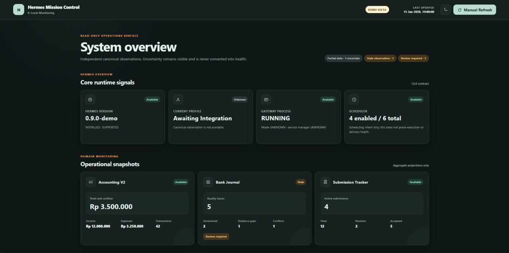
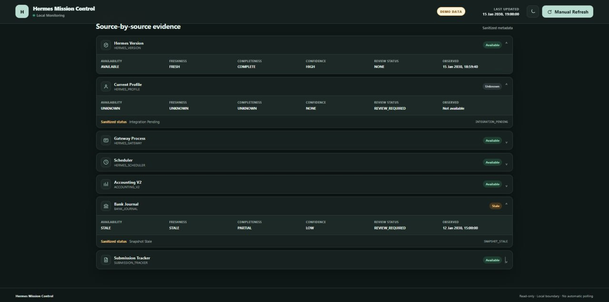
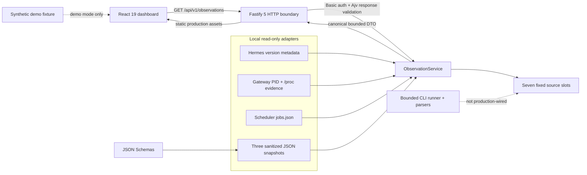

<div align="center">

# Hermes Mission Control

**A local, read-only operations dashboard for bounded observations of a Hermes Agent installation.**

[](#license)
[](#requirements)
[](https://www.typescriptlang.org/)
[](#architecture)

[Quick start](#quick-start) · [Architecture](docs/architecture.md) · [Security](#security-and-design) · [Contributing](#contributing)

</div>

> **Public staging status:** the dashboard and local observation pipeline are usable, but the integration surface is intentionally narrow. It is not a remote administration console and does not control Hermes.

## Why

Operational state is often spread across local process metadata, scheduler files, package metadata, and domain-specific snapshots. Hermes Mission Control turns those inputs into one small, typed observation contract without hiding uncertainty. It is designed to answer “what can this machine safely establish right now?” rather than infer health from missing or stale evidence.

The result is a deliberately conservative dashboard:

- **read-only by construction** — production adapters read approved local paths and the HTTP API rejects mutation methods;
- **honest about uncertainty** — `UNKNOWN`, `UNAVAILABLE`, `STALE`, freshness, confidence, and review state remain distinct;
- **privacy-minimizing** — the API exposes fixed aggregate projections, not raw files, command output, profile names, credentials, or message content;
- **local-first** — the production listener is fixed to `127.0.0.1` and protected by HTTP Basic authentication.

## Preview

### Dashboard Overview



The dashboard brings together Hermes runtime observations and domain-specific operational snapshots in one read-only view.

### Source-by-Source Evidence



Mission Control preserves availability, freshness, completeness, confidence, and review requirements according to the evidence available for each source.

> **Synthetic data disclosure:** All screenshots use synthetic demonstration data. No personal financial information, private records, credentials, or production observations are included.

## Features

### Available now

- React 19 dashboard with light/dark themes, explicit manual refresh, safe failure states, and no automatic polling.
- A fixed seven-slot observation contract, in stable order:
  1. Hermes version
  2. Hermes profile
  3. Hermes gateway
  4. Hermes scheduler
  5. Accounting V2
  6. Bank journal quality
  7. Submission tracker
- Local read-only adapters for installed Hermes version metadata, gateway PID/process evidence, scheduler registry, and three schema-validated snapshot formats.
- Fastify 5 endpoints for health and observations, with Ajv response validation.
- Loopback-only production binding, scrypt-backed Basic authentication, authentication failure limiting, security headers, redacted logs, and `no-store` responses.
- A bounded Hermes CLI runner and pure parsers. Only `hermes profile list` is currently live-validated; the runner is **not wired into the production observation composition**.
- A synthetic demo that does not require Hermes or read local production files.

### Planned or intentionally incomplete

- Production wiring for the `HERMES_PROFILE` slot. It currently reports `UNKNOWN` with `INTEGRATION_PENDING` even though a bounded, validated profile command/parser exists.
- Additional adapters only after their read-only behavior, output bounds, sanitization, and contracts are validated.
- Packaging and documented service-manager examples.
- Accessibility and browser-level regression coverage beyond the present component and contract tests.


No write controls, remote administration, secret inspection, or arbitrary command execution are planned.

## Architecture



The domain layer defines observation and freshness semantics. Adapter ports isolate local I/O. The application layer collects every slot concurrently and converts missing, failed, or invalid providers into explicit safe states. The HTTP layer authenticates and validates the bounded DTO; the web layer validates it again before rendering. See [docs/architecture.md](docs/architecture.md) for the complete layer and failure-state map.

## How it works

1. On each manual page load or refresh, the browser requests `GET /api/v1/observations` with same-origin credentials and caching disabled.
2. `ObservationService` invokes the configured providers for all seven fixed slots.
3. Adapters read only approved absolute paths, enforce path and size boundaries, parse strict formats, and return canonical `Observation<T>` values.
4. The service projects those values to privacy-minimized DTOs. Raw adapter data and raw CLI output do not cross the HTTP boundary.
5. Ajv validates the aggregate against the HTTP contract. The React client performs an additional exact-shape check before rendering.
6. Missing evidence stays missing: the UI presents `UNKNOWN`, `UNAVAILABLE`, or `STALE` rather than manufacturing a healthy state.

The demo is different: Vite loads a synthetic fixture directly in the browser only when running in development/demo mode on a loopback hostname with `?demo=1`.

## Project structure

```text
src/
├── domain/          # Framework-free observation, freshness, and snapshot rules
├── application/     # Seven-slot collection and bounded DTO projection
├── adapters/        # Read-only local adapters; bounded CLI runner and parsers
├── infrastructure/  # Environment config, adapter composition, static assets
├── security/        # Basic authentication, scrypt, failure limiting
├── http/            # Fastify app, schemas, routes, headers, public errors
├── web/             # React dashboard, client validator, synthetic demo fixture
└── bootstrap/       # Production composition root and loopback listener
schemas/             # JSON Schema contracts for sanitized snapshots
fixtures/            # Synthetic contract fixtures and privacy canaries
tests/               # Unit, contract, adapter, HTTP, security, and architecture tests
tools/               # Repository-specific foundation lint
docs/                # Architecture and public documentation
```

## Requirements

- **Node.js 24.x** (`>=24 <25`)
- **npm 11.x** (`>=11 <12`)
- A modern browser
- Hermes is **not** required for the synthetic demo
- For production mode: a local Hermes installation plus absolute paths to its approved metadata/profile inputs and all three schema-conforming sanitized snapshots

## Quick start

This is the exact path to the safe synthetic demo:

```bash
git clone https://github.com/rifkiilhambaihaki/hermes-mission-control.git
cd hermes-mission-control
npm ci
npm run demo
```

Open **http://127.0.0.1:4174/?demo=1**. Keep `?demo=1`; without it, the development UI attempts to call the authenticated API. The demo server binds only to `127.0.0.1`, and all displayed values come from `src/web/demo-fixture.ts`.

## Connecting your own Hermes installation

Production startup is fail-closed and environment-configured. It requires every variable below, uses fixed local filesystem adapters, and always listens on `127.0.0.1` (port `3200` by default).

1. Build both server and web assets:

   ```bash
   npm ci
   npm run build
   ```

2. Create an approved scrypt password hash without storing the plaintext password in a file:

   ```bash
   read -rsp 'Mission Control password: ' HMC_PASSWORD; echo
   export HMC_BASIC_PASSWORD_HASH="$(HMC_PASSWORD="$HMC_PASSWORD" node --input-type=module -e 'import { encodePasswordHash } from "./dist/server/security/scrypt-password.js"; console.log(await encodePasswordHash(process.env.HMC_PASSWORD))')"
   unset HMC_PASSWORD
   ```

3. Configure absolute paths for your installation. Replace every example path with a real local path:

   ```bash
   export HMC_BASIC_USERNAME='mission-control'
   export HMC_PORT='3200'
   export HMC_HERMES_PROFILE_ROOT="$HOME/.hermes"
   export HMC_HERMES_SITE_PACKAGES_ROOT='/absolute/path/to/python/site-packages'
   export HMC_HERMES_DISTRIBUTION_METADATA_DIR='/absolute/path/to/hermes_agent.dist-info'
   export HMC_HERMES_SOURCE_ROOT='/absolute/path/to/hermes-agent/source'
   export HMC_SCHEMA_ROOT="$PWD/schemas"
   export HMC_ACCOUNTING_SNAPSHOT_PATH='/absolute/path/to/accounting-v2.snapshot.json'
   export HMC_BANK_JOURNAL_SNAPSHOT_PATH='/absolute/path/to/bank-journal-quality.snapshot.json'
   export HMC_SUBMISSION_SNAPSHOT_PATH='/absolute/path/to/submission-tracker.snapshot.json'
   ```

4. Start the local server, then open `http://127.0.0.1:3200/` and enter the Basic-auth credentials:

   ```bash
   npm run start:local
   ```

Snapshot files must satisfy the schemas in [`schemas/`](schemas/README.md). Use sanitized aggregate snapshots only—never point these variables at raw financial, credential, chat, or submission databases. `HMC_PROC_ROOT` exists for controlled testing and defaults to `/proc`; do not override it in normal operation.

The current production composition reads version, gateway, scheduler, and the three snapshot sources directly. It does not invoke the Hermes CLI. Consequently, `HERMES_PROFILE` remains explicitly pending until a reviewed provider is wired into the composition root.

## Custom adapters

An adapter should implement the narrow port for its source and return `Promise<Observation<T>>`; it should not know about React or Fastify.

1. Define or reuse a domain data type under `src/domain/`.
2. Add a narrowly scoped adapter under `src/adapters/<source>/` that performs bounded, read-only I/O and returns a canonical observation.
3. Sanitize failures into stable error codes; never include paths, raw payloads, command output, or secrets in public errors.
4. Add the adapter to `ProductionLocalObservationAdapters` and wire it in `createProductionLocalObservationService()`.
5. Keep the API projector and browser validator synchronized, then add adapter, contract, privacy, and architecture tests.
6. Run `npm run quality`.

The seven source IDs are a contract, not a plugin registry. Replacing a provider is straightforward; adding an eighth slot is a versioned API/UI change. Review [docs/architecture.md](docs/architecture.md) before extending the composition.

## Security and design

- **Local boundary:** the production host is hard-coded to `127.0.0.1`; configuration cannot broaden it.
- **Authentication:** every registered route and static asset passes through Basic authentication. Passwords are verified against a policy-fixed scrypt hash with timing-safe comparison.
- **Transport:** Basic authentication is not encryption. Keep the app on loopback. If access must cross a machine boundary, place an authenticated TLS reverse proxy or SSH tunnel in front of it and assess that deployment separately.
- **Read-only API:** health and observations support `GET`/`HEAD`; mutation methods return `405`.
- **Read-only I/O:** production adapters use bounded file reads, reject symlinks/path escapes, and do not write to Hermes state.
- **Data minimization:** only allow-listed aggregate fields reach the client. Logs redact authorization, cookies, and password fields.
- **Fail closed:** malformed configuration stops startup; malformed observations and source failures become explicit non-success states.
- **No hidden background work:** the dashboard does not poll automatically, and production observation composition does not execute Hermes commands.

This is defense in depth, not a claim of formal security verification. Do not expose the Fastify listener directly to an untrusted network.

## Tests and quality gates

```bash
npm run typecheck       # server, web, and test TypeScript projects
npm run lint            # dependency-free repository lint
npm test                # Vitest suite
npm run build           # production server + web builds
npm run build:demo      # synthetic demo build
npm run quality         # all of the above
```

Tests cover contracts and freshness, semantic validation, adapters, bounded process behavior, authentication, HTTP responses, privacy canaries, frontend behavior, production builds, and dependency boundaries. The repository currently publishes no CI or coverage claim.

## Deployment

The supported production shape is a single local Node.js process serving the built React assets and authenticated API:

```bash
npm ci
npm run quality
# export the HMC_* variables documented above
npm run start:local
```

`dist/` is generated and should be rebuilt for each deployment. Run under an unprivileged account with read access only to the approved files. Keep secrets in the process environment or your service manager's protected secret facility, restrict snapshot permissions, and retain the loopback binding. A reverse proxy is optional for TLS but must connect locally; container, systemd, and public-cloud manifests are not currently provided.

## Roadmap

- [ ] Wire a reviewed production provider for the profile slot.

- [ ] Add browser-level accessibility and visual regression checks.
- [ ] Document hardened service-manager and loopback reverse-proxy examples.
- [ ] Evaluate additional read-only sources only with explicit contracts, bounds, and privacy tests.

Roadmap items are directional and do not imply a release date.

## Contributing

Issues and focused pull requests are welcome. Before submitting a change:

1. keep the dashboard read-only and local-first;
2. avoid personal, credential, raw command, or production data in fixtures, screenshots, logs, and commits;
3. preserve layer boundaries and explicit uncertainty semantics;
4. add tests for new behavior; and
5. run `npm run quality` successfully.

For adapter changes, describe the input authority, filesystem/process capabilities, bounds, sanitization, freshness policy, and failure mapping in the pull request.

## License

Licensed under the **MIT License**. See [`LICENSE`](LICENSE).

## Acknowledgements

- [Hermes Agent](https://github.com/NousResearch/hermes-agent) for the agent ecosystem this independent dashboard observes.
- The maintainers and contributors of React, Fastify, Vite, TypeScript, Ajv, and Vitest.

## Disclaimer

Hermes Mission Control is an **independent, non-official community project**. It is not maintained, endorsed, sponsored, or supported by Nous Research or the official Hermes Agent project. “Hermes” is used only to describe compatibility. Do not treat dashboard output as a substitute for source-system records, security monitoring, or professional financial/compliance review.

**Ringkasan:** dashboard lokal, hanya-baca, dan non-resmi untuk observasi Hermes; mode demo memakai data sintetis dan tidak memuat data pribadi atau produksi.
