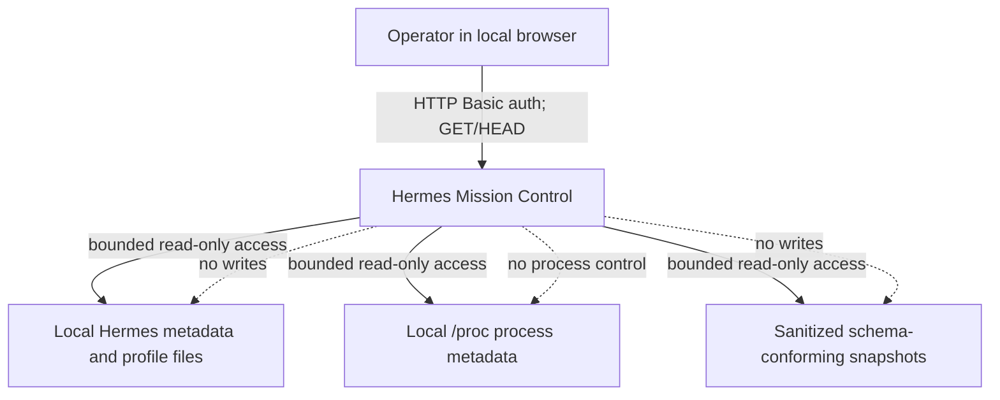
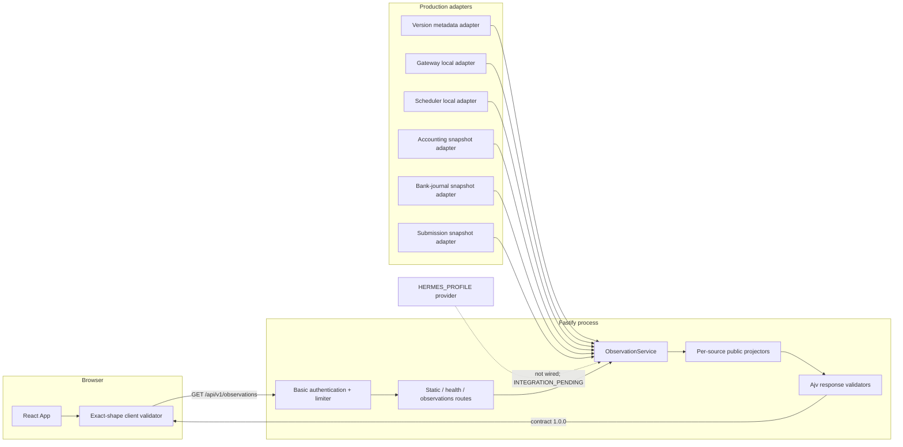
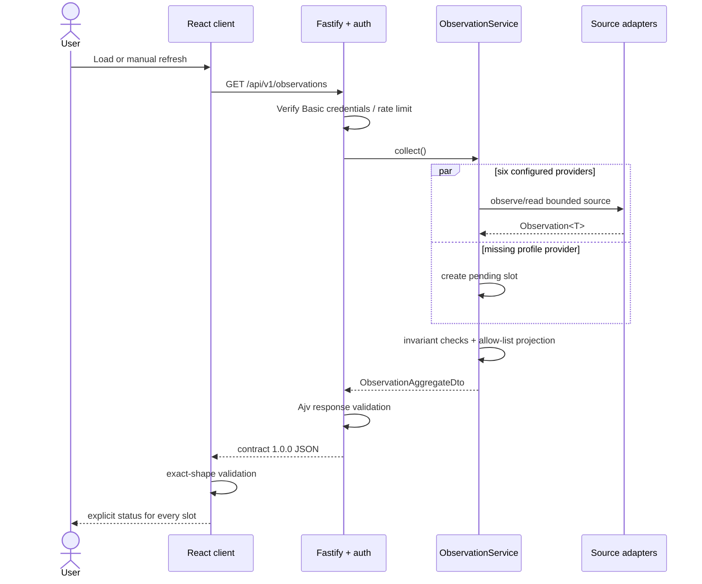
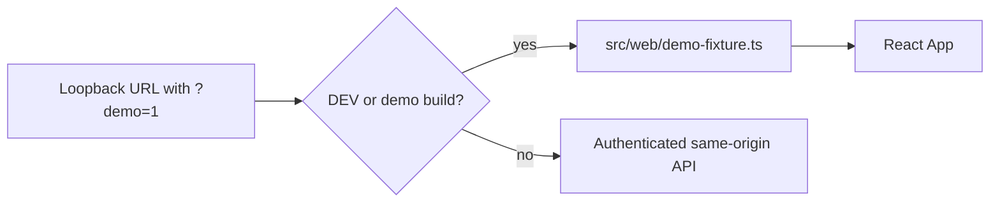

# Architecture

This document describes the implementation that exists in this repository. It distinguishes production-wired capabilities from components that are present but not connected. For operator instructions, start with the [root README](../README.md).

## Goals and constraints

Hermes Mission Control is a local, read-only observation surface. Its architecture is optimized for:

- a small, fixed public contract;
- explicit uncertainty rather than inferred health;
- bounded and allow-listed local I/O;
- privacy-minimized projections;
- separation between domain rules, capabilities, transport, and presentation; and
- a production server that cannot be configured to listen beyond IPv4 loopback.

It is not a control plane. There are no routes for changing Hermes configuration, starting processes, editing schedules, or mutating domain data.

## System context



The production process binds to `127.0.0.1`. Cross-host access is outside the application boundary and requires a separately secured tunnel or TLS reverse proxy.

## Runtime composition



`src/bootstrap/mission-control.ts` is the production composition root. It loads configuration, static assets, and the six production adapters, creates the Fastify application, and listens on loopback. Although the aggregate always includes seven slots, production currently configures only six providers. The profile slot therefore has deterministic pending behavior.

## Layers and dependency direction

### 1. Domain — `src/domain/`

The domain layer contains framework-free types and rules:

- the generic `Observation<T>` model;
- availability, completeness, confidence, review, and provenance invariants;
- freshness calculation;
- gateway and scheduler canonical data;
- sanitized snapshot types and semantic validation; and
- accounting asset cadence rules.

It does not import React, Fastify, adapters, infrastructure, filesystem APIs, child processes, or environment configuration. Architecture tests enforce this boundary.

### 2. Application — `src/application/observations/`

`ObservationService` owns the public aggregate shape and the fixed source registry:

```text
HERMES_VERSION
HERMES_PROFILE
HERMES_GATEWAY
HERMES_SCHEDULER
ACCOUNTING_V2
BANK_JOURNAL
SUBMISSION_TRACKER
```

Its responsibilities are to:

- call providers concurrently with `Promise.all`;
- preserve the fixed source order;
- enforce observation invariants and timestamps;
- project source data to allow-listed public fields;
- isolate provider failures per slot; and
- return contract version `1.0.0`.

The service has no filesystem, network, CLI, or database capability. A provider is simply `() => Promise<Observation<unknown>>`.

### 3. Adapters — `src/adapters/`

Production-wired adapters translate local evidence into domain observations:

- `hermes-version-metadata` reads approved package/distribution metadata and checks installation compatibility.
- `hermes-gateway-local` reads the profile's `gateway.pid` and bounded process evidence under `/proc`.
- `hermes-scheduler-local` reads the profile's `cron/jobs.json` registry and emits counts only.
- `accounting-v2-snapshot`, `bank-journal-quality-snapshot`, and `submission-tracker-snapshot` read fixed sanitized JSON snapshots and validate them against schemas.

These adapters use approved descriptors minted from server configuration. Filesystem adapters require absolute roots, enforce root containment, reject symlinks, use `O_RDONLY | O_NOFOLLOW`, cap input size/counts, and do not expose raw source objects to HTTP.

The `hermes-cli` subtree is a separate capability area containing:

- a frozen command registry;
- a spawn-only bounded process executor;
- timeout and stdout/stderr limits;
- a minimal child environment;
- concurrency control; and
- pure sanitizing parsers.

Only `HERMES_PROFILE_LIST` is marked `LIVE_VALIDATED`. Several historical commands are retired from live monitoring, and the rest are not approved or deferred. Crucially, the CLI runner is not imported by production infrastructure, HTTP, domain, or web code and is not currently a production data source.

### 4. Infrastructure — `src/infrastructure/`

Infrastructure turns runtime configuration into concrete capabilities:

- `runtime-config.ts` accepts Basic-auth settings and fixes the bind address to `127.0.0.1`.
- `static-frontend.ts` loads a bounded production asset bundle.
- `observations/production-local-observations.ts` creates approved descriptors, adapters, provider closures, and freshness policies.

This is the correct layer for replacing or wiring an adapter. Environment access is centralized here and in the bootstrap rather than spread through adapters.

### 5. Security — `src/security/`

The security layer implements:

- policy-fixed scrypt password encoding and verification;
- timing-safe derived-key comparison;
- Basic authentication parsing; and
- in-memory authentication failure delay/limiting.

The limiter permits fewer than five retained failures in a five-minute window, introduces delay after repeated failures, and returns `429` with `Retry-After` when blocked. A successful authentication clears retained failures. Because limiter state is process-local and global rather than per-client, it is a small local-boundary safeguard, not a distributed edge rate limiter.

### 6. HTTP — `src/http/`

Fastify owns the transport boundary:

- `GET/HEAD /api/v1/health` returns build/runtime metadata and the read-only/authenticated flags.
- `GET/HEAD /api/v1/observations` returns the seven-slot aggregate.
- `POST`, `PUT`, `PATCH`, and `DELETE` on those API routes return `405`.
- Production static assets are served from the same authenticated application.

Authentication is an application-wide `onRequest` hook, so static assets and API routes share the same boundary. Ajv 2020 validates health, observation, and public error responses. Public errors are generic. Logs omit query strings in request serialization and redact authorization, cookie, and password-shaped fields.

Every response receives `Cache-Control: no-store`, a restrictive Content Security Policy, `Referrer-Policy: no-referrer`, `X-Content-Type-Options: nosniff`, and a restrictive permissions policy. Server-identifying headers are removed.

### 7. Web — `src/web/`

The React application depends only on its API contract. It does not import server, adapter, filesystem, or runner modules. The API client:

- requests same-origin observations with `cache: "no-store"`;
- maps authentication, restriction, transport, and malformed-response failures to safe UI states; and
- validates exact keys, source order, enums, source-specific projections, and core invariants before rendering.

The UI loads once and refreshes only on explicit user action. It does not poll.

### 8. Bootstrap — `src/bootstrap/`

The bootstrap is the outermost composition layer. It validates `HMC_PORT`, loads required environment configuration, verifies the frontend build exists, creates production observations, installs shutdown handlers, and binds to `127.0.0.1`.

No alternate bind-address environment variable exists.

## Observation data flow



Provider calls are isolated. One source failure does not reject the whole aggregate. A failure in the aggregate clock or a response that fails the final HTTP schema is an endpoint-level failure.

## Public contract and minimization

Every slot contains only:

```text
source
availability
completeness
freshness
review_status
confidence_level
observation_timestamp
current
error_code
```

`current` is source-specific and tightly projected:

- **Version:** version, installation kind, metadata authority, consistency, compatibility, adapter version.
- **Profile:** profile count and current-profile count; names are excluded.
- **Gateway:** process/service state categories, mode, manager category, identity consistency, duplicate-definition state, and definition state.
- **Scheduler:** availability plus enabled and total job counts; schedule payloads are excluded.
- **Accounting:** aggregate IDR totals and transaction count.
- **Bank journal:** aggregate quality issue counts.
- **Submission tracker:** aggregate workflow counts.

The richer internal `Observation<T>` may carry confidence reasons, provenance source/fetch time, a sanitized error message, and last-known-good context. Those fields are not all projected to the current HTTP DTO. In particular, last-known-good data is not served by this API version.

## `UNKNOWN` and `UNAVAILABLE` behavior

These states are intentionally different and must not be collapsed into “offline” or “unhealthy.”

### `UNKNOWN`

`UNKNOWN` means Mission Control cannot make a supported determination from current evidence. It is not a transport-failure claim.

At the application boundary:

- A slot with no registered provider becomes:
  - `availability: "UNKNOWN"`
  - `completeness: "UNKNOWN"`
  - `freshness: "UNKNOWN"`
  - `review_status: "REVIEW_REQUIRED"`
  - `confidence_level: "NONE"`
  - `current: null`
  - `error_code: "INTEGRATION_PENDING"`
- A provider result that violates observation invariants, has invalid timestamps/error codes, or cannot be projected becomes the same null/none uncertainty shape with `error_code: "INVALID_OBSERVATION_CONTRACT"`.
- A schema-valid snapshot that explicitly declares snapshot status `UNKNOWN` remains `UNKNOWN`, with no current data and no confidence claim.
- Local adapters may return `UNKNOWN` for ambiguous or unsafe evidence such as a path-boundary violation, rejected symlink, invalid bounded record, or unsupported evidence. Their sanitized adapter code is retained when the result satisfies the observation contract.

**Current production example:** `HERMES_PROFILE` is always `UNKNOWN / INTEGRATION_PENDING` because no profile provider is wired into `createProductionLocalObservationService()`.

### `UNAVAILABLE`

`UNAVAILABLE` means a current observation attempt failed at the source/transport boundary. It requires a sanitized error and cannot contain current data or claim confidence.

At the application boundary:

- If a provider throws or rejects, the service emits:
  - `availability: "UNAVAILABLE"`
  - `completeness: "UNKNOWN"`
  - `freshness: "UNKNOWN"`
  - `review_status: "REVIEW_REQUIRED"`
  - `confidence_level: "NONE"`
  - `current: null`
  - `error_code: "SOURCE_OBSERVATION_FAILED"`
- If an adapter returns a valid `UNAVAILABLE` observation, its stable sanitized error code is projected. Examples include a required file becoming inaccessible during a bounded read.
- Internal last-known-good context may accompany an unavailable domain observation, but API contract `1.0.0` still serves `current: null`; it never substitutes historical data as current.

### Related non-success states

- `STALE` means data exists but its source timestamp crossed a freshness threshold. It is not rewritten as fresh, and the UI calls it out.
- `EMPTY` is a successful observation of an explicit empty representation. It requires `completeness: "EMPTY"`, current empty data, and no error.
- `EXPIRED` is a freshness value. Snapshot conversion exposes expired data with `availability: "STALE"`, preserving the more specific `freshness: "EXPIRED"`.

### UI and HTTP failures

The browser also distinguishes endpoint-level failures:

- `401` → `AUTH_REQUIRED`
- `403` or `429` → `ACCESS_RESTRICTED`
- network or other non-success response → `API_UNAVAILABLE`
- invalid JSON or contract mismatch → `MALFORMED_RESPONSE`

These are page/request failures, not source-slot `UNAVAILABLE` values.

## Freshness policies

The production composition currently applies these source-specific thresholds:

- Hermes gateway and scheduler: stale after 30 seconds, expired after 60 seconds.
- Accounting snapshot: stale after 24 hours, expired after 72 hours.
- Submission snapshot: stale after 7 days, expired after 30 days.
- Bank-journal snapshot: stale after 30 days, expired after 120 days.
- Snapshot future-clock tolerance: 5 minutes.

Version metadata uses its own adapter mapping rather than these time thresholds. Profile freshness has no production policy because the provider is not wired.

Thresholds describe evidence age, not end-to-end business health. Scheduler counts, for example, indicate configured scheduling intent and do not prove job execution or delivery.

## Demo architecture

Demo mode is deliberately separate from production composition:



The fixture is dynamically imported only when both conditions hold:

1. Vite is in development mode or the build mode is `demo`; and
2. the hostname is `127.0.0.1`, `localhost`, or `[::1]` with query parameter `demo=1`.

A normal production build does not enable this path merely because `?demo=1` is present. Demo values are synthetic and should remain free of personal or production data.

## Configuration boundary

Production requires:

- `HMC_BASIC_USERNAME`
- `HMC_BASIC_PASSWORD_HASH`
- `HMC_HERMES_PROFILE_ROOT`
- `HMC_HERMES_SITE_PACKAGES_ROOT`
- `HMC_HERMES_DISTRIBUTION_METADATA_DIR`
- `HMC_HERMES_SOURCE_ROOT`
- `HMC_SCHEMA_ROOT`
- `HMC_ACCOUNTING_SNAPSHOT_PATH`
- `HMC_BANK_JOURNAL_SNAPSHOT_PATH`
- `HMC_SUBMISSION_SNAPSHOT_PATH`

Optional values are `HMC_PORT` (default `3200`, allowed `1024`–`65535`) and the test-oriented `HMC_PROC_ROOT` (default `/proc`). Source and schema paths must be absolute. Missing or malformed required configuration prevents startup rather than silently disabling a source.

Although all source path variables are mandatory at startup, runtime evidence can still become `UNKNOWN`, `UNAVAILABLE`, `EMPTY`, or `STALE`; configuration validity and observation state are separate concerns.

## Extension rules

To replace a source implementation without changing the public contract:

1. implement the appropriate narrow adapter port;
2. return a valid `Observation<T>` for every expected outcome;
3. bound all I/O by path, size, time, and count as applicable;
4. convert sensitive/internal failures to stable codes;
5. wire the adapter only in infrastructure/composition;
6. preserve the application's allow-list projector; and
7. add contract, privacy, adapter, and architecture tests.

Adding a source is more invasive. The source IDs and order are repeated intentionally in the application contract, HTTP JSON Schema, browser parser, and UI. An eighth slot therefore requires a versioned contract decision and coordinated updates, not dynamic discovery.

A CLI-backed adapter must additionally use only a `LIVE_VALIDATED` frozen command, the bounded runner, the minimal child environment, and a pure parser. Raw stdout/stderr must terminate at the parser boundary and must never reach HTTP or logs.

## Verification boundaries

The test suite enforces more than behavior. It checks that:

- domain and web layers cannot acquire server/I/O capabilities;
- only the bounded executor imports `node:child_process` and it uses `spawn` only;
- production HTTP and infrastructure do not import CLI runner/parser internals;
- filesystem access is confined to approved adapters;
- adapter descriptors are minted only at approved locations;
- raw runner output remains inside the parser boundary;
- prohibited dependency classes are absent;
- API and snapshot schemas reject malformed or excess data; and
- privacy canaries cannot cross public contracts.

Run the complete gate with:

```bash
npm run quality
```

## Known limitations

- The profile provider is implemented only as separately tested CLI runner/parser pieces and is not production-wired.
- The failure limiter is in memory and resets with the process; it is appropriate only to the stated local deployment boundary.
- The backend has no TLS termination. Basic credentials are safe only within the trusted loopback boundary or behind separately configured encrypted transport.
- There is no persistence or cache coordination in Mission Control.
- There is no automatic refresh, alerting, event stream, or historical trend store.
- The three domain snapshots must be produced externally; this application only reads and validates them.
- A rendered dashboard screenshot is not shipped yet; use the verified synthetic demo for the current UI.
